# github-stats · Matrix Terminal Edition

This repository generates **terminal / Matrix-green** SVG cards for a GitHub
profile using GitHub Actions — no server required, refreshed daily, and able
to include **private repository** data through your own Personal Access Token.

Forked from [jstrieb/github-stats](https://github.com/jstrieb/github-stats)
(GPL-3.0), with rewritten templates plus pinned-repo cards, a contribution
heatmap and a contribution snake.

## Layout

| Path | Description |
|---|---|
| `templates/overview.svg` | Summary card (stars, forks, contributions, lines changed, views, repos) |
| `templates/languages.svg` | Top 6 languages as ASCII `█░` bars |
| `templates/pinned.svg` | Grid of the repositories pinned on the profile (up to 6, follows pin changes) |
| `templates/contributions.svg` | One-year contribution heatmap with current/longest streak and best day |
| `generate_images.py` | Fills the templates with data → `generated/*.svg` |
| `github_stats.py` | Queries the GitHub GraphQL/REST APIs |
| `assets/header.svg` | Animated typing terminal banner (static, edit by hand) |
| `generated/` | Committed by Actions: `overview.svg`, `languages.svg`, `pinned.svg`, `contributions.svg`, `snake-dark.svg`, `snake-light.svg` |
| `profile/README.md` | Complete profile README to copy into the profile repository |
| `.github/workflows/main.yml` | Runs daily at 00:05 UTC, on push to `master`, or manually |

## Setup

### 1. Create a Personal Access Token

The workflow needs its own token — the default Actions token cannot read user
data or private repositories.

**Classic token** (simplest): *Settings → Developer settings → Personal access
tokens → Tokens (classic) → Generate new token*

- Scopes: `repo` and `read:user`
- Expiration: your choice — renew it before it expires or the workflow will fail

> A freshly created token can take a few minutes to start working.

### 2. Add repository secrets

*Settings → Secrets and variables → Actions → New repository secret*

| Secret | Required | Example | Purpose |
|---|---|---|---|
| `ACCESS_TOKEN` | ✅ | `ghp_xxx…` | Token from step 1 |
| `EXCLUDED` | | `nolannguyen1212/dotfiles,org/legacy-app` | Repositories to skip when computing stats |
| `EXCLUDED_LANGS` | | `HTML,CSS,Jupyter Notebook` | Languages hidden from the languages card |

Forked repositories are already excluded (`EXCLUDE_FORKED_REPOS: true` in the
workflow).

> Tip for a Go/backend profile: add `HTML,CSS,SCSS,Jupyter Notebook` to
> `EXCLUDED_LANGS` so templates and notebooks don't skew the languages card.

### 3. Allow Actions to write

*Settings → Actions → General → Workflow permissions →* **Read and write
permissions** → Save. (The workflow already declares
`permissions: contents: write`, but some accounts/orgs still block it at the
repository level.)

### 4. Run the workflow

*Actions → Generate Stats Images → Run workflow*. After 1–3 minutes,
`generated/` contains the new SVGs. From then on the workflow runs daily.

> This repository must be **public** — the profile README embeds images via
> `raw.githubusercontent.com`, which is not reachable for private repositories.
> Private repository data only ever appears as aggregated numbers.

### 5. Create the profile README

1. Create a **public** repository named after your username:
   `nolannguyen1212/nolannguyen1212` (GitHub shows a "special repository"
   notice).
2. Copy [`profile/README.md`](profile/README.md) into that repository's
   `README.md`.
3. Adjust the personal parts:
   - the link badges at the top
   - the `nolan.yaml` block (role, domains, learning…)
   - the `~/stack` badges to match the technologies you actually use

## Customization

**Pinned repos** — no code changes needed: change your pins on the GitHub
profile and the next workflow run redraws `pinned.svg`. The card reads the pin
list itself, so keep your repositories pinned; GitHub's default pin boxes still
appear below the README and cannot be restyled.

**Recommended profile settings** (Settings → Public profile): enable *Include
private contributions on my profile* for a fuller heatmap; disable *Show
Achievements* for a cleaner sidebar.

**Header banner** — edit the text in `assets/header.svg`. Each line is "typed"
by animating the width of a `clipPath`; if you make a command longer, raise the
matching `to="520"` value (~8.4px per character).

**Colors** — palette shared by every file:

| Token | Hex | Used for |
|---|---|---|
| background | `#0a0f0a` | card background |
| title bar | `#0f1a10` | window title bar |
| phosphor | `#00ff41` | prompt, language bars, border |
| mid green | `#00c72c` | keys, percentages |
| bright text | `#b6ffc6` | values |
| dim | `#1f5f2c` | dot leaders, empty bar track |

**Language count / bar length** — `MAX_LANGUAGES` and `BAR_WIDTH` near the top
of the image generation section in `generate_images.py`.

**Schedule** — edit `cron` in `.github/workflows/main.yml`.

## Accuracy notes

- *Lines of code changed* and *views* come from GitHub's statistics APIs; they
  may be incomplete on the first run and become more accurate as GitHub caches
  the data (see
  [jstrieb#2](https://github.com/jstrieb/github-stats/issues/2),
  [#3](https://github.com/jstrieb/github-stats/issues/3),
  [#13](https://github.com/jstrieb/github-stats/issues/13)).
- Views cover only the last 14 days and only repositories you can push to.
- If `aiohttp` raises an exception, the (public) Actions log may reveal the
  **names** of private repositories. Keep this in mind before using a token
  with the `repo` scope.

## License

GPL-3.0 — see [LICENSE](LICENSE). Original code © Jacob Strieb.
